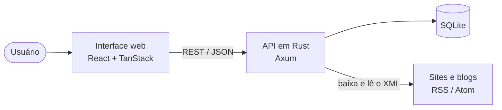
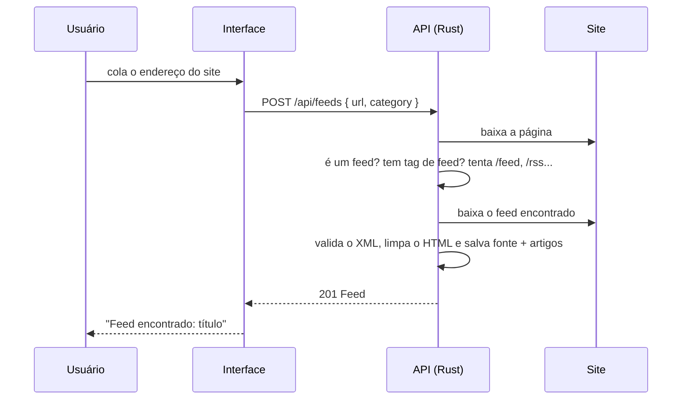

# NEXUS FEED

**Um agregador de notícias RSS/Atom com visual futurista.** Você cadastra os sites e blogs que acompanha, e o NEXUS FEED reúne tudo em um só lugar: busca, filtros, favoritos e controle do que já foi lido.


## Índice

- [O que é](#o-que-é)
- [O que ele faz](#o-que-ele-faz)
- [Como funciona](#como-funciona)
- [Tecnologias](#tecnologias)
- [Como rodar](#como-rodar)
- [API REST](#api-rest)
- [Segurança e confiabilidade](#segurança-e-confiabilidade)
- [Estrutura do projeto](#estrutura-do-projeto)
- [Testes](#testes)
- [Limitações e próximos passos](#limitações-e-próximos-passos)

## O que é

Quase todo site de notícias, blog ou canal publica um **feed**: um arquivo XML (nos formatos **RSS** ou **Atom**) que lista, de forma padronizada, os conteúdos mais recentes com título, resumo, link, data e imagem. Um **agregador de feeds** lê vários desses arquivos e mostra tudo numa lista única, sem algoritmo de recomendação e sem precisar visitar cada site.

O NEXUS FEED é um agregador completo, dividido em duas partes independentes que conversam por uma API REST:

| Parte | Onde fica | Responsabilidade |
|---|---|---|
| **Interface web** | raiz do repositório (`src/`) | Telas, filtros, busca, favoritos e leitura |
| **API em Rust** | [`backend/`](backend/README.md) | Baixar e interpretar os feeds, guardar tudo no banco e responder à interface |

O visual segue um tema escuro por padrão, com fundo preto-azulado, gradientes em roxo, violeta e ciano, efeito *glassmorphism* discreto e animações suaves.

## O que ele faz

### Cadastro de fontes
- Aceita o **endereço do site** (com ou sem `https://`) ou o link direto do feed.
- Se você colar só o site, a API **procura o feed sozinha** (veja [Busca automática do feed](#busca-automática-do-feed)).
- Valida o XML **antes de salvar**. Se o site não oferecer feed, mostra uma mensagem explicando.
- Detecta fontes duplicadas, mesmo quando o usuário cola o site de um feed já cadastrado.
- Permite remover a fonte logo após o cadastro ou depois, na página de fontes (com confirmação).

### Leitura
- **Início:** saudação, resumo (total de artigos, não lidos, favoritos e fontes), aviso de fontes com erro e as últimas notícias.
- **Todas as notícias:** lista paginada, da publicação mais recente para a mais antiga.
- **Favoritos:** os artigos que você salvou.
- **Categorias:** cada assunto com a contagem de artigos e fontes.
- **Fontes RSS:** status de cada fonte, data da última atualização, atualização individual, acesso ao site original e remoção.
- Em cada artigo: **favoritar**, **marcar como lido ou não lido** e **abrir o original**.

### Busca e filtros
- Busca global no cabeçalho, no título, no resumo e no nome da fonte.
- Filtros por **categoria**, **fonte** e **período** (24 horas, 7 dias, 30 dias ou tudo).
- Os filtros ficam na URL (por exemplo, `/articles?category=Tecnologia&period=7d`), então links podem ser compartilhados e o botão voltar do navegador funciona.

### Atualização dos feeds
- A API atualiza todas as fontes automaticamente (a cada 15 minutos por padrão).
- Também é possível atualizar manualmente, todas de uma vez (cabeçalho) ou uma por vez (página de fontes).
- Artigos já conhecidos não são duplicados, e o estado de lido e favorito é preservado.
- Se uma fonte falhar, o motivo aparece nela e o restante continua funcionando.

### Experiência de uso
- Estados de carregamento (*skeletons*), lista vazia, erro de conexão e ausência de resultados.
- Layout responsivo, com menu lateral que vira menu móvel.
- Acessibilidade: link "Pular para o conteúdo", rótulos ARIA, foco visível e navegação por teclado.
- Mensagens de sucesso e erro em notificações discretas.

## Como funciona



A interface nunca fala com os sites diretamente. Ela pede tudo à API, e a API é quem baixa, valida, interpreta e guarda os feeds.

### O caminho de uma nova fonte



### Busca automática do feed

Ao receber uma URL, a API tenta, nesta ordem, e usa o primeiro resultado que for um feed válido:

1. **O próprio link já é um feed** (RSS, Atom ou JSON Feed): é usado como está.
2. **Feed anunciado na página:** lê as tags `<link rel="alternate" type="application/rss+xml" href="...">` do HTML, resolvendo endereços relativos. Feeds de comentários ficam por último.
3. **Caminhos comuns:** `/feed`, `/rss`, `/rss.xml`, `/atom.xml`, `/feed.xml`, `/index.xml`, `/feeds/posts/default` e, se o link tem caminho (como `/blog`), também `/blog/feed` e `/blog/rss`.

Os candidatos são testados em paralelo. A fonte é salva com o **endereço real do feed** encontrado. Se nada servir, a API responde com uma mensagem clara e não salva nada.

### Importação dos artigos

Para cada item do feed, a API:
- extrai título, link, autor, data de publicação, resumo e imagem (da mídia do item ou da primeira imagem do HTML);
- converte o resumo em **texto puro**, removendo tags, scripts e estilos;
- descarta itens sem link `http(s)` válido;
- limita datas no futuro (feeds mal configurados) ao momento atual;
- grava tudo no SQLite, atualizando o que já existe sem perder lido e favorito.

### Camada de serviços do frontend

A interface usa exclusivamente `http-api.ts`, que conversa com a API Rust por meio de `VITE_API_BASE_URL`.
No desenvolvimento local, o endereço padrão é `http://localhost:3000`; não há dados fictícios nem adaptador de demonstração.

## Tecnologias

| Camada | Tecnologias |
|---|---|
| **Interface** | React 19, TypeScript, TanStack Start (renderização no servidor), TanStack Router e Query, Tailwind CSS 4, Framer Motion, Lucide, shadcn/ui, Sonner |
| **API** | Rust, Axum 0.8, Tokio, SQLx (SQLite), reqwest (rustls), feed-rs (interpretação de RSS/Atom/JSON Feed), scraper (HTML), tower-http (CORS e logs), tracing |
| **Testes** | Vitest e Testing Library (interface), `cargo test` com servidores locais de teste (API) |

## Como rodar

**Pré-requisitos:** [Rust](https://rustup.rs) 1.85 ou superior e Node.js 20 ou superior. O Bun pode ser usado para instalar as dependências.

O comando de desenvolvimento inicia a API Rust, espera a resposta de `/api/health` e então inicia a interface. Na primeira execução, a compilação do Rust pode levar alguns minutos.

```bash
cp .env.example .env
cp backend/.env.example backend/.env # opcional; os padrões já funcionam
bun install              # ou: npm install --legacy-peer-deps
bun run dev              # ou: npm run dev
```

A interface abre em **http://localhost:8080** e a API em **http://localhost:3000**. O banco SQLite é criado automaticamente em `backend/nexus_feed.db`.

Para publicar a interface e a API em hosts diferentes, configure `VITE_API_BASE_URL` no ambiente de build do frontend e inclua a origem do frontend em `CORS_ORIGINS` no backend.

### Configuração da API (`backend/.env`)

| Variável | Padrão | Descrição |
|---|---|---|
| `HOST` / `PORT` | `127.0.0.1` / `3000` | Endereço da API |
| `DATABASE_URL` | `sqlite://nexus_feed.db` | Arquivo do banco |
| `CORS_ORIGINS` | `localhost` e `127.0.0.1`, portas 8080 e 5173 | Origens permitidas do frontend |
| `REFRESH_INTERVAL_MINUTES` | `15` | Atualização automática (`0` desativa) |
| `ALLOW_PRIVATE_URLS` | `false` | **Só para desenvolvimento:** permite feeds em localhost |

## API REST

| Método | Rota | O que faz |
|---|---|---|
| GET | `/api/feeds` | Lista as fontes |
| POST | `/api/feeds` | Cadastra uma fonte (site ou feed) e devolve a fonte criada |
| DELETE | `/api/feeds/:id` | Remove a fonte e seus artigos |
| POST | `/api/feeds/:id/refresh` | Atualiza a fonte |
| GET | `/api/articles` | Lista artigos (`q`, `category`, `feedId`, `period`, `favorite`, `unread`, `page`, `limit`) |
| GET | `/api/articles/:id` | Detalhe de um artigo |
| POST | `/api/articles/:id/favorite` | Define favorito (`{ "favorite": true }`) |
| POST | `/api/articles/:id/read` | Define lido (`{ "read": true }`) |
| GET | `/api/health` | Verificação de saúde |

Os erros seguem sempre o formato `{ "error": { "code": "...", "message": "..." } }`. A documentação completa, com tipos TypeScript e exemplos, está em [`backend/README.md`](backend/README.md).

## Segurança e confiabilidade

Como é o **servidor** que baixa as URLs informadas pelos usuários, o backend se protege:

- **Proteção contra SSRF:** só aceita endereços públicos `http(s)`. Bloqueia localhost, redes privadas, *link-local* e CGNAT, inclusive em redirecionamentos e nos endereços descobertos dentro das páginas.
- **Conteúdo dos feeds é tratado como não confiável:** resumos viram texto puro, e links e imagens só são aceitos se forem `http(s)` (bloqueia `javascript:` e `data:`).
- **Limites:** feeds de até 5 MB, tempo máximo de 15 segundos por download e 100 itens por feed.
- **SQL seguro:** todos os valores entram como parâmetros preparados.
- **Erros internos não vazam:** os detalhes vão para o log, e o cliente recebe uma mensagem genérica.
- **Falhas isoladas:** uma fonte com problema não derruba as outras, e o status do erro fica visível na interface.

## Estrutura do projeto

```
.
├── src/                       Interface web
│   ├── routes/                Páginas: início, articles, favorites, categories, sources
│   ├── components/nexus/      Componentes do produto (menu, cabeçalho, cards, filtros, modal...)
│   ├── components/ui/         Componentes base (shadcn/ui)
│   ├── hooks/                 Hooks de dados (React Query) e ações com notificações
│   ├── services/              Contrato da API e cliente HTTP
│   ├── types/                 Tipos TypeScript (Feed, Article...)
│   └── test/                  Testes da interface
├── scripts/                   Inicialização coordenada da API e da interface
├── backend/                   API em Rust
│   ├── src/
│   │   ├── routes/            Endpoints (feeds, articles) e CORS
│   │   ├── services/          Download, busca automática e leitura de feeds; atualização
│   │   ├── models.rs          Tipos do banco e do JSON
│   │   ├── repository.rs      Consultas SQL compartilhadas
│   │   └── error.rs           Erros padronizados
│   ├── migrations/            Esquema do banco (SQL)
│   └── tests/                 Teste de ponta a ponta com servidores RSS locais
└── public/                    Ícone e arquivos estáticos
```

## Testes

```bash
bun run test             # interface (Vitest)
bun run lint             # ESLint + Prettier
cd backend && cargo test # API: unitários + ponta a ponta, sem precisar de internet
```

Os testes da API sobem servidores HTTP locais que simulam sites com e sem feed, o que permite verificar a busca automática, as duplicatas, os filtros, a paginação e a remoção em cascata sem depender de sites reais.

